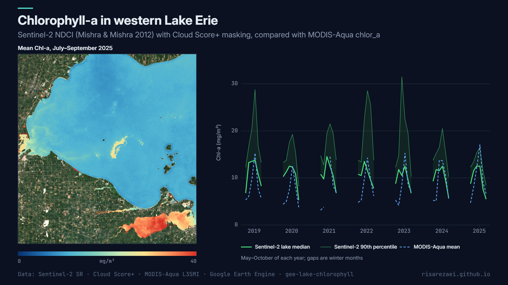

# Lake Chlorophyll-a Monitor

Track **chlorophyll-a and algal-bloom intensity** in lakes and reservoirs with Sentinel-2 and the **Normalized Difference Chlorophyll Index (NDCI)**, and cross-check it against the **MODIS-Aqua** ocean-colour chlorophyll product.

Example output for the western basin of Lake Erie: mean Chl-a for July–September 2025, and monthly values for May–October 2019–2025 (from the exported table).

## What the script does

1. Takes Sentinel-2 L2A surface reflectance and removes clouds with **Cloud Score+**.
2. Keeps only **permanent water** (JRC occurrence ≥ 80 %), so shorelines and flooded fields don't bias the result.
3. Computes **NDCI = (B5 − B4) / (B5 + B4)** and converts it to Chl-a with the Mishra & Mishra (2012) polynomial.
4. Builds monthly composites and reports the lake **median** and **90th percentile** (bloom hot spots), plus the clear-water area used.
5. Adds the **MODIS-Aqua** monthly mean (4.6 km) for comparison where the lake is large enough.
6. Maps the **seasonal mean Chl-a** for a chosen year and exports a CSV (and optionally a GeoTIFF).

## Quick start

1. Open the [Earth Engine Code Editor](https://code.earthengine.google.com).
2. Paste [`lake_chlorophyll.js`](lake_chlorophyll.js) into a new script.
3. Set `lake` to a rectangle or polygon around your lake, and the dates.
4. Press **Run**, then start the exports from the **Tasks** tab.

## Configuration

| Parameter | Default | Description |
|---|---|---|
| `lake` | Western Lake Erie | Area around the lake (land is masked out) |
| `start` / `end` | 2023–2025 | Period. For longer records, use the CSV export (it runs as a batch task) |
| `months` | `[5, 10]` | Calendar months to include (bloom season) |
| `minCloudScore` | `0.65` | Cloud Score+ threshold (higher = stricter) |
| `minWaterOccurrence` | `80` | JRC water occurrence (%) for the water mask |
| `coeffs` | Mishra & Mishra (2012) | `c0 + c1·NDCI + c2·NDCI²` |
| `seasonMap` | 2025, July–September | Year and months of the map |
| `includeModis` | `true` | Add the MODIS-Aqua comparison |

## Output

`lake_chla_monthly.csv`: `month, n_images, valid_km2, chl_median, chl_p90, ndci_median, modis_chl`

## Notes

- The NDCI polynomial was fitted for turbid, productive waters. In clear lakes, read the values as a **relative bloom index**, or recalibrate `coeffs` with your own field samples.
- MODIS-Aqua chlorophyll uses an ocean algorithm; it often reads low in turbid inland water, but its timing is a useful check.
- Months with less than 50 km² of clear water are left out of the chart. They stay in the CSV, so you can filter them yourself.

## References

- Mishra, S. & Mishra, D. R. (2012). Normalized difference chlorophyll index: A novel model for remote estimation of chlorophyll-a concentration in turbid productive waters. *Remote Sensing of Environment*, 117, 394–406.
- Pasquarella, V. J. et al. (2023). Cloud Score+ for Sentinel-2. Earth Engine dataset [`GOOGLE/CLOUD_SCORE_PLUS/V1/S2_HARMONIZED`](https://developers.google.com/earth-engine/datasets/catalog/GOOGLE_CLOUD_SCORE_PLUS_V1_S2_HARMONIZED).

## Author

**Parisa Abbasalizadehrezaei** · [risarezaei.github.io](https://risarezaei.github.io)

Released under the [MIT License](LICENSE).
